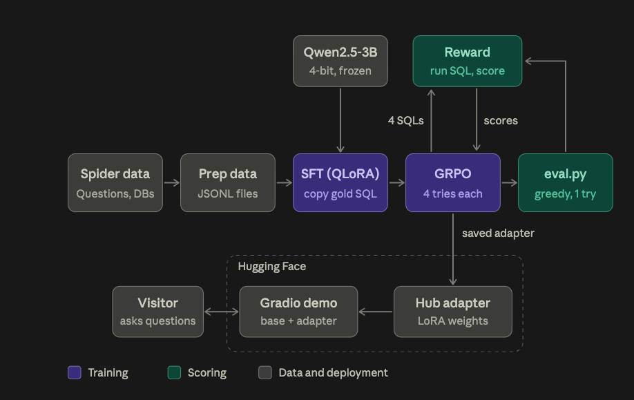

# Text-to-SQL GRPO

Post-train **Qwen2.5-3B-Instruct** for text-to-SQL with **QLoRA SFT + GRPO**
(3000 prompts × 4 generations) on Spider execution rewards. Open harness, Gradio
demo with Hub LoRA adapter, and measured Spider **dev** eval below.

| Asset | Link |
|-------|------|
| Hub adapter | [`abhisheksutaria/qwen2.5-3b-grpo-text-to-sql`](https://huggingface.co/abhisheksutaria/qwen2.5-3b-grpo-text-to-sql) |
| Live demo | [`abhisheksutaria/text-to-sql-grpo`](https://huggingface.co/spaces/abhisheksutaria/text-to-sql-grpo) · [direct Gradio](https://abhisheksutaria-text-to-sql-grpo.hf.space) |

**Not** part of the Future of Jobs Vite app — standalone Python project.



*Pipeline overview — Text-to-SQL RLVR pipeline (SFT → GRPO → eval → Hugging Face).*

## Quick start

```bash
git clone https://github.com/abhishek-sutaria/text-to-sql-grpo.git
cd text-to-sql-grpo
python -m venv .venv && source .venv/bin/activate
pip install -e ".[dev]"
# or: pip install -r requirements.txt && pip install -e .
```

### Smoke tests (no GPU required)

```bash
# Unit tests: SQL exec + reward scoring
pytest -q

# Harness eval without loading a LLM (oracle + heuristic baselines)
python scripts/eval.py --data data/sample/dev.jsonl --mode oracle --out outputs/oracle.json
python scripts/eval.py --data data/sample/dev.jsonl --mode heuristic --out outputs/heuristic.json

# Prepare processed copies
python scripts/prepare_data.py --source sample
```

### Gradio demo (local)

```bash
pip install -r requirements-spaces.txt
python app.py
# open http://127.0.0.1:7860
```

Without `MODEL_ID`, the app uses a schema-aware stub so Spaces stay CPU-friendly.
With a GPU / enough RAM:

```bash
export MODEL_ID=Qwen/Qwen2.5-3B-Instruct
# optional LoRA after training:
# export ADAPTER_ID=outputs/smoke_sft/adapter
python app.py
```

## Training

### Smoke SFT / GRPO (tiny steps — needs GPU for Qwen-3B in practice)

```bash
# QLoRA SFT — 2 steps on 8 sample rows
python scripts/train_sft.py --config configs/smoke_sft.yaml

# GRPO — 2 steps, G=2 generations, execution reward
python scripts/train_grpo.py --config configs/smoke_grpo.yaml \
  --sft-adapter outputs/smoke_sft/adapter
```

CPU can load tiny models only; **Qwen2.5-3B smoke train expects CUDA + bitsandbytes**.
The reward/exec harness itself is CPU-only and fully tested.

### Full recipe (overnight lean run — measured results below)

1. Download Spider 1.0:

```bash
python scripts/download_spider.py
# if auto-download fails: get the zip from https://yale-lily.github.io/spider
# place as data/spider_data.zip and re-run with --zip data/spider_data.zip
python scripts/prepare_data.py --source spider --out-dir data/processed
```

2. SFT then GRPO (lean 4090 settings used for the published metrics):

```bash
python scripts/train_sft.py --config configs/lean_full_sft.yaml
python scripts/train_grpo.py --config configs/lean_full_grpo.yaml
```

`configs/lean_full_grpo.yaml` runs **3000 prompts × 4 generations** with
validity / execution / correctness rewards (`0.2 / 0.3 / 0.5`).
Larger-GPU variants: `configs/full_sft.yaml` / `configs/full_grpo.yaml`.

3. Eval comparisons:

```bash
python scripts/eval.py --data data/processed/dev.jsonl --model Qwen/Qwen2.5-3B-Instruct \
  --out outputs/eval_base.json
python scripts/eval.py --data data/processed/dev.jsonl --model Qwen/Qwen2.5-3B-Instruct \
  --adapter outputs/full_sft/adapter --out outputs/eval_sft.json
python scripts/eval.py --data data/processed/dev.jsonl --model Qwen/Qwen2.5-3B-Instruct \
  --adapter outputs/full_grpo/adapter --out outputs/eval_grpo.json
```

Published JSON for the overnight run is checked in under `results/eval/`.

## Reward design

For each completion:

1. **Validity** — parseable SQLite SQL (`sqlglot`)
2. **Execution** — runs read-only on the example DB
3. **Correctness** — result bag equals gold query result

```text
total = 0.2 * validity + 0.3 * execution + 0.5 * correctness
```

## Repo layout

```text
app.py                 Gradio demo (HF Spaces entrypoint)
configs/               smoke_*, lean_full_* (published), full_* YAML
data/sample/           Mini Spider-like SQLite DBs + JSONL
results/               MEASURED_RESULTS.md + eval/ JSON from Spider dev
scripts/               download / prepare / train_sft / train_grpo / eval
src/text_to_sql_grpo/  prompts, spider exec, rewards
tests/                 unit tests for exec + rewards
```

## Deploy to Hugging Face Spaces

**Note:** Gradio on `cpu-basic` needs [HF PRO](https://huggingface.co/pro) (quota 0 otherwise). Free ZeroGPU uses `hardware: zero-a10g` plus `@spaces.GPU` on the Gradio generation handler (`app.py`).

1. Create a Space (Gradio SDK) or reuse `abhisheksutaria/text-to-sql-grpo`.
2. Upload `app.py`, `src/`, `data/sample/`, and `requirements-spaces.txt` as Space `requirements.txt`.
3. Use `README_spaces.md` YAML as the Space README (`app_file: app.py`, `hardware: zero-a10g`).
4. Space vars: `MODEL_ID=Qwen/Qwen2.5-3B-Instruct` (default on ZeroGPU). Secret `ADAPTER_ID` for GRPO LoRA. See `docs/PORTFOLIO_ALIGNMENT.md`.

```bash
# from a machine with `huggingface-cli` logged in:
huggingface-cli upload <user>/text-to-sql-grpo . --repo-type=space
```

## Repository

Public repo: https://github.com/abhishek-sutaria/text-to-sql-grpo

Hugging Face Space (ZeroGPU + GRPO adapter): https://huggingface.co/spaces/abhisheksutaria/text-to-sql-grpo

## Measured results (Spider dev, n=1034)

From overnight QLoRA SFT + GRPO (`configs/lean_full_*.yaml`) via `scripts/eval.py`.
Full write-up + raw JSON: [`results/MEASURED_RESULTS.md`](results/MEASURED_RESULTS.md).

| Checkpoint | Exec accuracy | Exec success | Mean reward |
|------------|---------------|--------------|-------------|
| Base (`Qwen2.5-3B-Instruct`) | **60.83%** | **88.78%** | **0.770** |
| SFT | **61.70%** | 81.33% | 0.752 |
| GRPO (3000×4) | **62.67%** | 82.40% | 0.761 |

**Story:** GRPO **+1.8 pp** exec accuracy vs base (+1.0 pp vs SFT). Base still leads
exec success / mean reward on this harness; SFT/GRPO trade some success for higher
exact-match correctness. Adapter: [`abhisheksutaria/qwen2.5-3b-grpo-text-to-sql`](https://huggingface.co/abhisheksutaria/qwen2.5-3b-grpo-text-to-sql).

## License

MIT. Spider data is subject to its own academic license — download separately for full runs.
